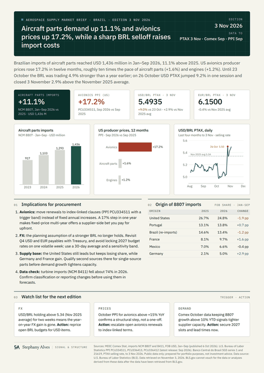
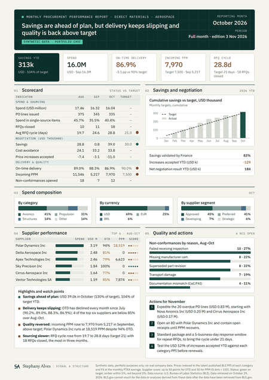
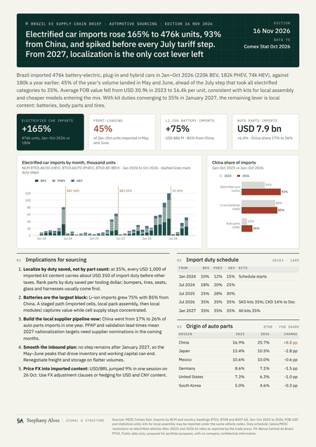
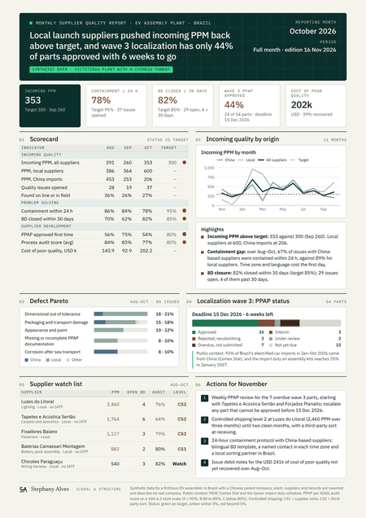
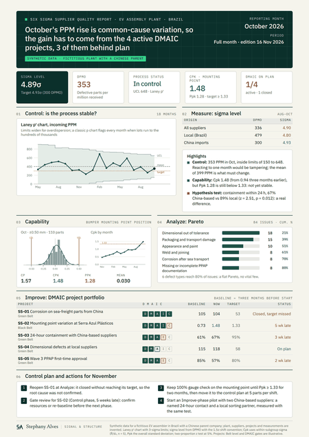
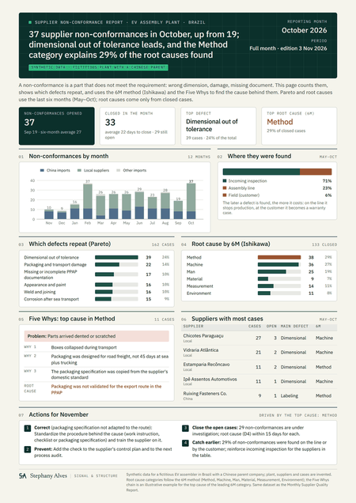
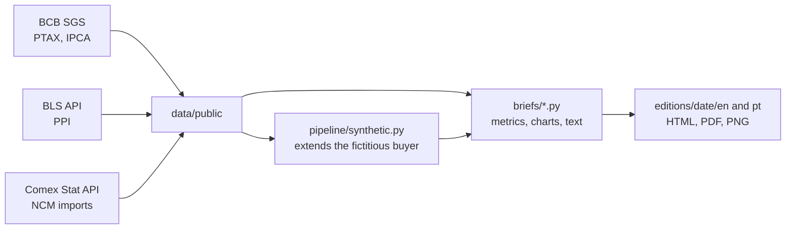

# Procurement Market Briefs

One-page decision briefs for procurement, rebuilt every month from public data, in English and Brazilian Portuguese.

Each page answers one sourcing question with numbers that come straight from official sources (or from a documented synthetic dataset), and ends with actions. A GitHub Actions workflow downloads the data, regenerates the twelve PDFs (six briefs in two languages) and commits the new edition on the 16th of every month.

| Aerospace Supply Market Brief | Monthly Procurement Performance Report |
|---|---|
|  |  |
| Is the aircraft parts market pushing price, FX or capacity, and what should buyers do? | Is procurement delivering savings, delivery and quality on target, and which actions fix the gaps? |
| Public data: Comex Stat, BLS PPI, BCB PTAX | Synthetic data, indexed to public prices and FX |

| Brazil EV Supply Chain Brief | Monthly Supplier Quality Report |
|---|---|
|  |  |
| How do Brazil's import duty steps and localization change EV sourcing? | At an EV plant localizing parts in Brazil, are suppliers meeting PPM, containment, 8D and PPAP targets, and where to act first? |
| Public data: Comex Stat, Gecex duty schedule | Synthetic data for a fictitious plant with a Chinese parent company; public context from Comex Stat |

| Six Sigma Supplier Quality Report |
|---|
|  |
| Is the incoming defect rate a stable process or a special cause, how capable is a critical characteristic, and are the DMAIC projects delivering? Laney p′ chart, DPMO and sigma level, Cp/Cpk/Ppk, Pareto, two-proportion z test, DMAIC portfolio. |
| Same synthetic EV plant, plus invented measurements and projects (`pipeline/sixsigma_synthetic.py`) |

| Supplier Non-Conformance Report |
|---|
|  |
| A simpler read of the same plant: how many non-conformances, where they were found, which defects repeat (Pareto), the root cause by 6M (Ishikawa), a Five Whys example and corrective and preventive actions. |
| Same synthetic EV plant; root causes assigned to closed cases only (`root_cause()` in `pipeline/sqe_synthetic.py`) |

All editions, in both languages: [editions/](editions/README.md). Versão em português das páginas: mesma pasta, subpasta `pt`.

## How it works



1. **Fetch** (`pipeline/fetch_public.py`). Downloads PTAX and IPCA from the Banco Central do Brasil, producer price indexes from the U.S. Bureau of Labor Statistics and import statistics by NCM from MDIC Comex Stat. Each source fails soft: if an API is down, the last file is kept and the edition states how far each source goes. Every successful download is logged in `data/public/sources_status.json`.
2. **Synthetic data** (`pipeline/synthetic.py`). The monthly report uses a fictitious aerospace buyer. The dataset keeps a hidden "truth" with real future dates (when a purchase order will actually arrive, when a quality notification will close) and exports only what a buyer would see on the cutoff date. Each month is appended with its own seed; past records are never rewritten.
3. **Build** (`briefs/`). Every number, chart and sentence is computed from the data, including the headline, highlights and actions, which change wording when the data changes direction. Pages render to A4 with Playwright and tighten spacing automatically if the text runs long.
4. **Publish** (`.github/workflows/monthly-briefs.yml`). Runs on the 16th, after Comex Stat (early month) and the BLS PPI (mid-month) are out. It runs the tests first, then commits the edition and attaches it as a workflow artifact.

### Data vintage in the manifest

Each `editions/<date>/manifest.json` says how fresh the data behind the edition is, so a fail-soft run cannot look newer than it is:

- `fetch`: `run`, or `skipped` when the edition was built with `--skip-fetch`.
- `sources`: one entry per public series, with `source_period` (last period in the file), `expected_period` (what should be out on the edition date), `fetched_at` (last successful download, UTC), `published_at` (release date reported by the source, when it gives one) and `status`:
  - `current`: downloaded in this run and covering the expected period.
  - `carried_forward`: downloaded in this run, but the source has not released the expected period yet.
  - `fetch_failed`: the download failed and the file from an earlier run was used.
  - `skipped`: the run used `--skip-fetch`.
- `briefs[].periods`: the period behind each brief's headline numbers (for example `ppi: 2026-10`, or `report_through` for the synthetic reports).
- `warnings`: every skipped or failed source, every series behind its expected period (`partial coverage`), and, when an old edition is rebuilt from newer files, every series that goes past what was public on the edition date (`possible hindsight`).

When a series is behind, the brief's source line also says so, for example "Partial coverage: BLS PPI through Sep 2026 (Oct 2026 not yet available)." The expected periods use typical release days (Comex Stat by the 10th, IPCA by the 12th, BLS PPI by the 16th), set in `briefs/vintage.py`.

### Tests

`python -m pytest` runs in a few seconds and checks:

- **Cutoff view** (`tests/test_cutoff_view.py`): with fixed mid-month cutoffs, no receipt, closure, decision, audit or measurement dated after the cutoff reaches the exported data, and items closed later still show as open.
- **Stability** (`tests/test_stability.py`): extending the procurement truth from October to November, in a temporary copy of `data/`, leaves October's tables and headline numbers identical and only appends records; the supplier quality and Six Sigma history up to October is the same whatever the cutoff.
- **Vintage** (`tests/test_vintage.py`): skipped, failed, late or carried-forward series always produce a warning.

## Run it locally

```bash
pip install -r requirements.txt
python -m playwright install chromium
# the pages load the fonts in fonts/ directly; installing them on your system is optional

python run_edition.py --skip-fetch                                   # rebuild with the data in the repository
python run_edition.py                                                # fetch fresh data and build today's edition
python run_edition.py --date 2026-10-29 --report-cutoff 2026-10-28 --skip-fetch   # reproduce the first edition
python -m pytest -q                                                  # cutoff, stability and vintage tests
```

Set `BLS_API_KEY` (free registration at bls.gov) to avoid the low daily limit of anonymous BLS requests. In GitHub, add it as a repository secret with the same name.

## Repository layout

| Path | Content |
|---|---|
| `run_edition.py` | Orchestrates fetch, synthetic extension and the six builds |
| `briefs/` | One module per brief, shared helpers (`common.py`) and the design system (`style.py`) |
| `pipeline/fetch_public.py` | BCB, BLS and Comex Stat downloads; logs each download in `data/public/sources_status.json` |
| `briefs/vintage.py` | Data vintage of each public series: period covered, period expected, status and partial-coverage note |
| `tests/` | Cutoff, stability and vintage tests (pytest) |
| `pipeline/synthetic.py` | Extends and views the synthetic procurement dataset |
| `pipeline/sixsigma_synthetic.py` | Measurements of a critical characteristic (subgroups of 5) and the DMAIC project portfolio for the Six Sigma report |
| `pipeline/sqe_synthetic.py` | Generates the supplier quality dataset (receipts, quality issues and 8D, PPAP by localization wave, process audits) and exports the view as of the report cutoff |
| `pipeline/init_truth.py`, `pipeline/legacy/` | One-time reconstruction of the synthetic truth from the original generator (seed 42) |
| `data/public/` | Public data used by the briefs |
| `data/synthetic/` | Fictitious aerospace buyer (POs, RFQs, quality notifications, targets) and, in `sqe/`, the fictitious EV plant's supplier quality data |
| `config/context.json` | Optional human-written context for one edition (for example, the event behind an FX move) |
| `editions/` | Every edition, in `en/` and `pt/` |
| `docs/pt-BR/` | Step-by-step guide (Portuguese) |

## Limitations

- **Comex Stat** counts vehicles by NCM. Kits for local assembly may be reported under the same codes as finished cars, which lowers the average FOB value per unit.
- **The 2026 kit duty rates** in the EV brief come from trade press coverage of Gecex decisions. Check the official resolution before relying on them.
- **BLS revises the PPI** for four months after release. Each run takes the revisions, so a past month can move slightly between editions.
- **One-session FX moves** are detected automatically (2% or more in the last 30 days). The reason behind a move is only stated when it is written in `config/context.json`, and the wording stays factual.
- **Synthetic data** is labeled on the page and in the footer. No record comes from any real company. The supplier quality report describes a fictitious EV assembler; supplier names are invented, and any resemblance to real companies is unintended.
- **Supplier quality methods** follow common automotive practice (AIAG PPAP, 8D, controlled shipping CS1/CS2, a VDA 6.3 style audit scale) at a portfolio level of detail; real programs set their own targets and rules.

## About

Built by Stephany Alves, industrial engineer with four years in aerospace procurement and supplier management, to practice the decision pages she would want on a sourcing manager's desk. Developed with AI pair programming (Claude); the business questions, metrics, data logic and review are mine.

Design: Stephany Alves Design System 2.0 (SIGNAL & STRUCTURE): Deep Forest and Mineral Bronze palette, Newsreader, IBM Plex Sans and IBM Plex Mono, and the official C2 symbol files in `briefs/brand/`. Code under the MIT License; data keeps the terms of its sources; fonts under the SIL Open Font License.

[LinkedIn](https://www.linkedin.com/in/stephany-alves)
