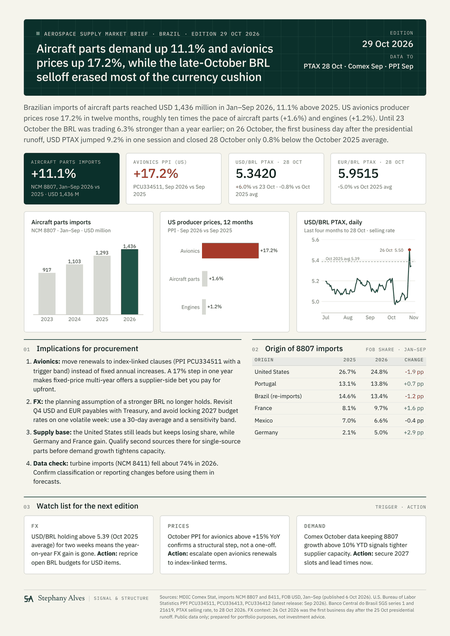
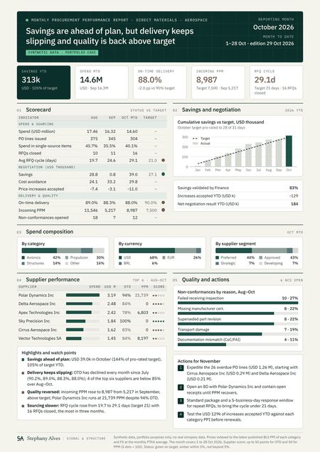
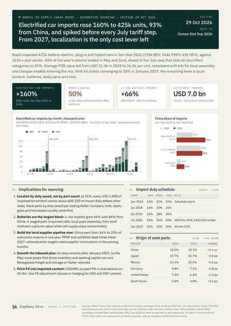
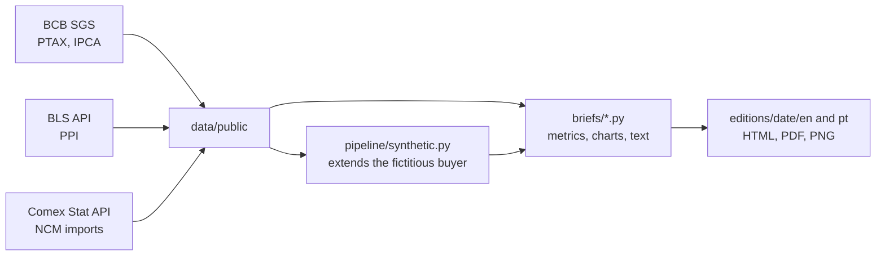

# Procurement Market Briefs

One-page decision briefs for procurement, rebuilt every month from public data, in English and Brazilian Portuguese.

Each page answers one sourcing question with numbers that come straight from official sources (or from a documented synthetic dataset), and ends with actions. A GitHub Actions workflow downloads the data, regenerates the six PDFs and commits the new edition on the 16th of every month.

| Aerospace Supply Market Brief | Monthly Procurement Performance Report | Brazil EV Supply Chain Brief |
|---|---|---|
|  |  |  |
| Is the aircraft parts market pushing price, FX or capacity, and what should buyers do? | Is procurement delivering savings, delivery and quality on target, and which actions fix the gaps? | How do Brazil's import duty steps and localization change EV sourcing? |
| Public data: Comex Stat, BLS PPI, BCB PTAX | Synthetic data, indexed to public prices and FX | Public data: Comex Stat, Gecex duty schedule |

All editions, in both languages: [editions/](editions/README.md). Versão em português das páginas: mesma pasta, subpasta `pt`.

## How it works



1. **Fetch** (`pipeline/fetch_public.py`). Downloads PTAX and IPCA from the Banco Central do Brasil, producer price indexes from the U.S. Bureau of Labor Statistics and import statistics by NCM from MDIC Comex Stat. Each source fails soft: if an API is down, the last file is kept and the edition states how far each source goes.
2. **Synthetic data** (`pipeline/synthetic.py`). The monthly report uses a fictitious aerospace buyer. The dataset keeps a hidden "truth" with real future dates (when a purchase order will actually arrive, when a quality notification will close) and exports only what a buyer would see on the cutoff date. Each month is appended with its own seed; past records are never rewritten.
3. **Build** (`briefs/`). Every number, chart and sentence is computed from the data, including the headline, highlights and actions, which change wording when the data changes direction. Pages render to A4 with Playwright and tighten spacing automatically if the text runs long.
4. **Publish** (`.github/workflows/monthly-briefs.yml`). Runs on the 16th, after Comex Stat (early month) and the BLS PPI (mid-month) are out, commits the edition and attaches it as a workflow artifact.

## Run it locally

```bash
pip install -r requirements.txt
python -m playwright install chromium
# install the fonts in fonts/ on your system so the PDF uses the design system typography

python run_edition.py --skip-fetch                                   # rebuild with the data in the repository
python run_edition.py                                                # fetch fresh data and build today's edition
python run_edition.py --date 2026-10-29 --report-cutoff 2026-10-28 --skip-fetch   # reproduce the first edition
```

Set `BLS_API_KEY` (free registration at bls.gov) to avoid the low daily limit of anonymous BLS requests. In GitHub, add it as a repository secret with the same name.

## Repository layout

| Path | Content |
|---|---|
| `run_edition.py` | Orchestrates fetch, synthetic extension and the six builds |
| `briefs/` | One module per brief, shared helpers (`common.py`) and the design system (`style.py`) |
| `pipeline/fetch_public.py` | BCB, BLS and Comex Stat downloads |
| `pipeline/synthetic.py` | Extends and views the synthetic dataset |
| `pipeline/init_truth.py`, `pipeline/legacy/` | One-time reconstruction of the synthetic truth from the original generator (seed 42) |
| `data/public/` | Public data used by the briefs |
| `data/synthetic/` | Fictitious buyer: suppliers, materials, POs, RFQs, quality notifications, targets |
| `config/context.json` | Optional human-written context for one edition (for example, the event behind an FX move) |
| `editions/` | Every edition, in `en/` and `pt/` |
| `docs/pt-BR/` | Step-by-step guide (Portuguese) |

## Limitations

- **Comex Stat** counts vehicles by NCM. Kits for local assembly may be reported under the same codes as finished cars, which lowers the average FOB value per unit.
- **The 2026 kit duty rates** in the EV brief come from trade press coverage of Gecex decisions. Check the official resolution before relying on them.
- **BLS revises the PPI** for four months after release. Each run takes the revisions, so a past month can move slightly between editions.
- **One-session FX moves** are detected automatically (2% or more in the last 30 days). The reason behind a move is only stated when it is written in `config/context.json`, and the wording stays factual.
- **Synthetic data** is labeled on the page and in the footer. No record comes from any real company.

## About

Built by Stephany Alves, production engineer with four years in aerospace procurement and supplier management, to practice the decision pages she would want on a sourcing manager's desk. Developed with AI pair programming (Claude); the business questions, metrics, data logic and review are mine.

Design: Stephany Alves Design System (SIGNAL & STRUCTURE). Code under the MIT License; data keeps the terms of its sources; fonts under the SIL Open Font License.

[LinkedIn](https://www.linkedin.com/in/stephany-alves)
